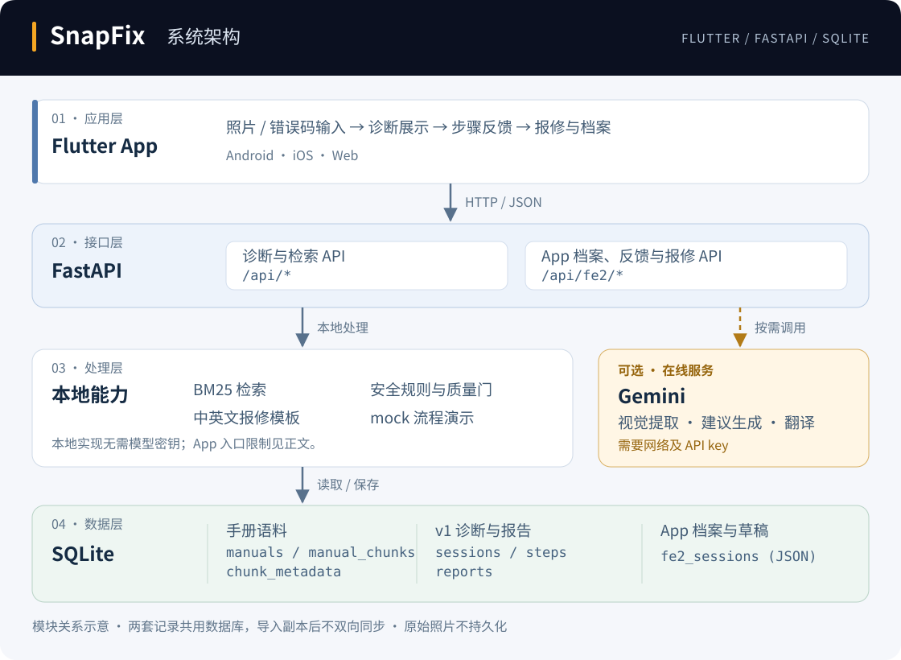

# SnapFix 随手修

> 拍下问题，核对依据，再决定自行处理、联系房东或预约专业人员。
> *Snap it. Fix it. Or report it.*

COMP7506A Smart Phone Apps Development 小组项目。SnapFix 是一款以 Flutter 开发的跨平台手机应用，配合 FastAPI 后端，帮助租户记录家电或家具问题、查找说明书依据、获得安全处理建议，并生成中英文报修草稿。

本 README 说明如何取得源码、安装依赖、编译及运行应用。课程所需的背景调研、应用设计和成员贡献说明见 [项目报告草稿](docs/final-report-draft.md)。

默认电脑已有 VS Code、Git 和浏览器。先检查 Python 与 Flutter，缺少时再安装，再按第 5–8 节运行浏览器版；已有工具均无需重复下载。Android/iOS 运行仅面向已有对应开发环境的用户。

## 1. 项目功能

| 功能 | 当前行为 |
|---|---|
| 拍照或相册选择 | App 支持相机和相册。在线诊断经 v1 图片质量门；无 key 时 App 仅验证图片格式、大小并保存待处理记录，可通过显式预览体验演示。 |
| 手动错误码诊断 | v1 接口可离线检索 Bosch E24 对应的洗碗机说明书第 35 页。当前 App 的该入口仍受在线能力开关控制，无 key 时不调用此检索。 |
| 手册检索 | 使用 BM25，对品牌别名、设备类别提示和错误码精确匹配加权；无匹配时明确返回空结果。 |
| 安全处理 | 高风险维修请求返回拒答和专业求助建议，不提供拆机步骤。 |
| 分步反馈 | 用户可将步骤标记为完成、没用或跳过；反馈会写入 SQLite。 |
| 报修草稿 | App 支持房东、维修师傅和售后三类接收人、中英文模板、编辑保存、复制与分享；具体语言和步骤规则见第 12 节。 |
| 维修档案 | SQLite 保存记录。App 档案与 v1 诊断分别存储，删除范围见第 12 节；原始照片不持久化。 |
| 离线演示 | App 通过“预览使用流程”显式进入演示；v1 图片接口另有约定文件名的 mock。演示结果不代表真实识别。 |

## 2. 系统架构

系统采用 Flutter + FastAPI + SQLite。下图只展示主要模块；接口与存储细节见 [后端说明](server/README.md)。

[](docs/assets/system-architecture.svg)

[打开架构大图](docs/assets/system-architecture.svg)（SVG 矢量图，可放大查看）。

实线表示本地调用或数据读写，虚线表示可选在线调用。这是模块关系图，不是每次请求都会遍历所有模块。

- 本地与在线：BM25、SQLite、App 模板及显式 mock 预览不需要 key。Gemini 才需要网络及 key；App 的在线能力开关目前也限制了手动检索入口，具体限制见第 12 节，不能把图中的本地检索能力理解为 App 离线入口已完全接通。
- 诊断路径：在线照片先做质量检查，再调用视觉提取、安全检查、检索与生成；手动错误码可直接使用本地检索。v1 图片接口按约定文件名回退的 mock，与 App 主动选择的预览入口是两种演示入口。
- 存储与报告：两套接口共用一个数据库文件，但 App 导入的是 v1 诊断副本；反馈、报告及删除并未双向同步。v1 报告与 App 接收人模板是两套实现，不能互相替代验收。

v1 诊断使用 `source_mode` 区分来源：`mock` 为演示数据，`retrieval` 为本地手册检索，`gemini` 为在线管线返回的数据，不等同于人工核验准确。App 档案另用 `mode=live/demo` 区分正式输入与流程预览；`live` 不表示诊断一定成功，仍应查看 `diagnosis_status`。

## 3. 代码结构

```text
app/                         Flutter 手机应用
  lib/product/               当前产品界面和 API 调用
  integration_test/          App 集成测试
server/                      FastAPI 后端
  main.py                    v1 API 和请求校验
  ui_api.py                  App 档案、反馈、接收人模板与适配接口
  run_fe2_preview.py         同时提供编译后的网页与 API
  pipeline.py                图片质量、视觉、检索、安全和引用校验流程
  retrieval.py               BM25、别名、同义词和加权排序
  session_store.py           SQLite 档案、反馈和报告存储
  corpus_store.py            JSON 语料导入
  data/                      说明书元数据、切块和公开 PDF
  tests/                     后端自动化测试
docs/                        API 契约、调研、验收、演示说明和报告草稿
landing/                     静态项目展示页
```

## 4. 环境要求

| 组件 | macOS | Windows |
|---|---|---|
| Python | Python 3.11 或以上 | Python 3.11 或以上，并在安装时勾选 Add Python to PATH |
| Flutter | 建议 Flutter 3.47.9；项目要求 Dart ^3.13.4，由 Flutter SDK 提供 | 同 macOS |
| 网络 | 首次安装 Python 与 Flutter 依赖时需要 | 首次安装 Python 与 Flutter 依赖时需要 |

SQLite 随 Python 提供，不需要额外安装数据库服务。没有 Gemini key 也可运行 v1 手册检索、App 档案、显式流程预览和基础中英文报修；不具备在线照片识别能力。

### 检查 Python（已有则跳过安装）

默认使用已有 Git 和浏览器，不再列出下载安装步骤。推荐先用浏览器体验完整界面，这条路线不需要下载或启动 Xcode、Android Studio，也不需要手机模拟器。网页由本机服务提供，并非已部署的在线模拟器。

macOS 在 VS Code 终端执行：

```bash
python3 --version
```

Windows PowerShell 执行：

```powershell
python --version
```

显示 Python 3.11 或以上即可跳过安装。找不到命令或版本过低时，从 [macOS 下载页](https://www.python.org/downloads/macos/) 或 [Windows 下载页](https://www.python.org/downloads/windows/) 安装 Python；Windows 勾选 **Add Python to PATH**。安装后重开 VS Code 终端并重新检查。

### 检查 Flutter（已有则跳过安装）

两种系统均执行：

```bash
flutter --version
```

版本满足上表要求即可跳过下面的下载步骤，直接进入第 5 节。

如果终端运行 `flutter --version` 显示 `command not found` 或“找不到 flutter”，表示 Flutter SDK 尚未安装，或没有加入系统 PATH。请先完成本节，再继续第 8 节。

**macOS：**

1. 在 VS Code 左侧 Extensions 搜索并安装官方 **Flutter** 扩展。Dart 扩展会一同安装。
2. 按 `Cmd + Shift + P` 打开 Command Palette，输入并选择 `Flutter: New Project`。
3. 当 VS Code 询问 Flutter SDK 位置时，选择 **Download SDK**，选择一个没有空格的安装目录，例如 `~/develop`。
4. 等待 SDK 下载及初始化完成；如出现 **Add SDK to PATH**，点击它。随后关闭并重新打开 VS Code 的终端。这里只安装 SDK，不需要为 SnapFix 新建 Flutter 项目。
5. 在终端执行：

   ```bash
   flutter doctor
   flutter --version
   ```

   若 Flutter 和 Chrome 显示通过，即可走浏览器路线。Android、Xcode 或 CocoaPods 的警告只需在选择相应手机路线时解决；无需等所有项目变绿才体验网页。

**Windows：**

1. 在 VS Code 安装官方 **Flutter** 扩展。
2. 按 `Ctrl + Shift + P`，选择 `Flutter: New Project`，再选择 **Download SDK**。
3. 选择没有空格、也不需要管理员权限的目录，例如 `C:\Users\你的用户名\develop`。
4. 等待 SDK 下载及初始化完成，点击出现的 **Add SDK to PATH**。关闭并重新打开 VS Code 与 PowerShell，然后执行：

   ```powershell
   flutter doctor
   flutter --version
   ```

若仅运行浏览器版，不需要处理 Android、Xcode 或 CocoaPods 的工具链提示。

官方安装说明见 [Flutter Install](https://docs.flutter.dev/install) 与 [Flutter PATH 设置](https://docs.flutter.dev/install/add-to-path)。

## 5. 获取源码

以下命令适用于 macOS 终端及 Windows PowerShell，下载当前集成代码基线。最终提交版本如采用其他分支或标签，应以随提交提供的版本为准。

```bash
git clone --branch integration/w3-product https://github.com/junjiacaohku-ai/snapfix.git
cd snapfix
```

在 VS Code 选择 **File → Open Folder**，打开包含 `README.md`、`app`、`server` 的这一层文件夹。如果已经有本项目，不要重复 clone；先确认现有版本包含 `server/run_fe2_preview.py` 和 `app/lib/product/`。源码 ZIP 也可使用，但应下载相同的集成分支并先解压。

后续称运行 Python 的窗口为“终端 A”，运行 Flutter 的窗口为“终端 B”。使用菜单 **Terminal → New Terminal** 新建终端，每次先确认当前目录；不要把终端提示符中的 `%`、`$` 或用户名复制进命令。

## 6. 配置后端并导入语料

在项目根目录的终端 A 执行对应系统的一组命令。它们创建 Python 环境、安装依赖并导入说明书；此时暂不启动服务器。

### macOS

```bash
cd server
python3 -m venv .venv
source .venv/bin/activate
python -m pip install -r requirements.txt -r requirements-dev.txt
python -X utf8 corpus_store.py --database data/snapfix.db
```

### Windows PowerShell

```powershell
cd server
python -m venv .venv
.\.venv\Scripts\python.exe -m pip install -r requirements.txt -r requirements-dev.txt
.\.venv\Scripts\python.exe -X utf8 corpus_store.py --database data/snapfix.db
```

Windows 命令直接使用虚拟环境中的 Python，不需要激活脚本或修改 PowerShell 执行策略。若 `python --version` 不可用但 `py --version` 可用，仅将创建环境的命令换为 `py -m venv .venv`。

导入完成时应显示：

```json
{"manuals": 16, "chunks": 2032}
```

导入后保持终端 A 位于 `server`。无需单独安装 SQLite，也不用手动创建表。可跳过可选的第 7 节，继续第 8 节。

## 7. Gemini 与离线模式

默认没有 key 时，后端运行在确定性的离线 mock 模式。它适合测试和课堂备用演示，但不代表真实图片识别结果。

此节可选。只有需要在线照片诊断或 v1 报告翻译时才配置 key。终端 A 已经在 `server`，不要再次执行 `cd server`。仅在没有 `.env` 时复制模板；已有文件直接编辑，避免覆盖自己的配置。

### macOS

```bash
cp .env.example .env
```

### Windows PowerShell

```powershell
Copy-Item .env.example .env
```

编辑 `.env`：

```dotenv
GEMINI_API_KEY=你的真实密钥
```

配置 key 且没有设置 `SNAPFIX_MOCK=1` 时，图片接口会尝试真实管线。真实图片或生成调用失败后，只有文件名符合约定的演示图片才会回退到 mock 场景。`.env`、数据库和 `.venv` 已被忽略，不能提交到 Git。

如要强制图片离线演示，可在 `.env` 增加 `SNAPFIX_MOCK=1`；恢复在线诊断时删除该行或设为 `0`，并检查终端是否也设置了同名环境变量。环境变量优先于 `.env`，修改配置后需停止并重启服务。此开关控制图片模式，不关闭 v1 报告的可选翻译；App 报修模板另见第 12 节。

## 8. 编译和运行 Flutter App

### 推荐：浏览器运行完整 App

这是第一次使用时最简单的路径。它会编译 Flutter 前端，并由一个 FastAPI 服务同时提供 App 页面和 API。**运行本节前，不要另外启动 `uvicorn`，否则会占用 8000 端口。**

使用 **Terminal → New Terminal** 打开终端 B，确认在项目根目录，再执行（两种系统相同）：

```bash
cd app
flutter pub get
flutter build web
```

最后应显示 `Built build/web`。这一步生成网页文件，还没有启动服务；不要直接双击 `build/web/index.html`。

构建完成后，回到第 6 节已经配置好的 `server` 终端，执行以下对应命令。

**macOS：**

```bash
python run_fe2_preview.py
```

**Windows PowerShell：**

```powershell
.\.venv\Scripts\python.exe run_fe2_preview.py
```

终端应显示 `Uvicorn running on http://127.0.0.1:8000`，且之后没有启动错误。保持终端 A 运行，在 Chrome 打开 [http://127.0.0.1:8000](http://127.0.0.1:8000)。同一服务的接口调试页面在 [http://127.0.0.1:8000/docs](http://127.0.0.1:8000/docs)。

首次无 key 体验：点击“预览使用流程”，选择路由器场景，标记一个步骤为“完成”、一个为“没用”，生成中英文草稿，编辑保存，再到档案查看。E24 预览不提供拆装步骤；这属于当前预期行为。

停止服务时在终端 A 按 `Ctrl + C`（Mac 为 Control，不是 Command）。重新运行时使用上面的同一条启动命令。端口占用请按第 14 节处理，不要重复启动多个服务。

### （可选）手机应用：Android / iOS 编译与运行

以下面向已经配置好 Xcode/iOS Simulator 或 Android Studio/Android Emulator 的用户，无需重复下载安装。只想体验界面与业务流程时，使用上面的浏览器版即可；相机、权限及系统分享仍需手机端单独验收。

切换到手机路线时，先在终端 A 按 `Ctrl + C` 停止网页预览服务，再在原来的 `server` 目录运行以下 API 服务。不要让两种启动方式同时占用 8000。

先在 `server` 终端运行后端 API：

**macOS：**

```bash
python -m uvicorn main:app --host 127.0.0.1 --port 8000
```

**Windows PowerShell：**

```powershell
.\.venv\Scripts\python.exe -m uvicorn main:app --host 127.0.0.1 --port 8000
```

### macOS：iOS Simulator

打开已有的 iOS Simulator，并用 `flutter doctor` 确认 iOS 工具链可用。本节不包含 Xcode 下载与环境初始化；未配置该环境时先使用浏览器路线。

以下命令在终端 B 的 `app` 目录执行；若仍在项目根目录，先执行 `cd app`。`DEVICE_ID` 替换为 `flutter devices` 列出的 iOS 模拟器 ID。

```bash
flutter pub get
flutter devices
flutter run -d DEVICE_ID --dart-define=SNAPFIX_API=http://127.0.0.1:8000
```

`flutter run` 会编译并启动应用。如需仅编译模拟器版本，在 `app` 执行：

```bash
flutter build ios --simulator --debug --dart-define=SNAPFIX_API=http://127.0.0.1:8000
```

模拟器构建位于 `app/build/ios/iphonesimulator/`，不能直接安装到真实 iPhone。真实 iPhone 还需 Apple 签名、设备信任及相应网络配置。

### Windows / macOS：Android Emulator

在已有 Android Studio 的 Device Manager 中启动已配置的模拟器，并用 `flutter doctor` 确认 Android 工具链可用。未配置该环境时先使用浏览器路线，无需为了浏览器体验下载 Android Studio。

以下命令在终端 B 的 `app` 目录执行，两种系统相同；`DEVICE_ID` 替换为 Android 模拟器 ID：

```powershell
flutter pub get
flutter devices
flutter run -d DEVICE_ID --dart-define=SNAPFIX_API=http://10.0.2.2:8000
```

`10.0.2.2` 是 Android Emulator 访问开发电脑后端的专用地址。Windows 不能运行 iOS Simulator；macOS 可以运行 Android Emulator，但连接地址仍使用 `10.0.2.2`。

仅编译用于模拟器测试的 debug APK：

```bash
flutter build apk --debug --dart-define=SNAPFIX_API=http://10.0.2.2:8000
```

输出为 `app/build/app/outputs/flutter-apk/app-debug.apk`。该地址用于 Android Emulator，给真实手机使用前需要重新配置后端地址并构建。正式发布另需签名与 HTTPS 配置，不能直接把此调试包当成已验证的发布版本。

### 真实手机连接

手机与电脑须处于可互通的局域网。电脑端 API 应绑定局域网可访问地址（如 `--host 0.0.0.0`），手机端 `SNAPFIX_API` 使用电脑的局域网 IP，例如 `http://192.168.1.20:8000`，不能使用手机自己的 `127.0.0.1` 或模拟器专用的 `10.0.2.2`。允许系统防火墙中该本地服务的入站连接。iOS 本地网络权限及 HTTP 策略也需在目标设备验证；当前未声明完成实机验收。

## 9. 使用流程

1. 无 key 先从“预览使用流程”选择路由器等场景；演示与正式档案分开。要测试真实照片识别，先完成第 7 节配置。
2. 正式照片输入在在线能力开启时走 v1 图片质量、视觉、检索和安全流程；无 key 时仅保存待处理记录并明确提示能力尚未支持。
3. 可在 `/docs` 调用 `POST /api/manuals/search`，输入 `{"query":"Bosch E24","brand":"Bosch","error_code":"E24","limit":3}`，验证无 key 的本地检索。App 的手动输入限制见第 12 节。
4. 有步骤的记录可标记“完成”“没用”或“跳过”；无步骤或高风险记录不应强行添加演示维修步骤。
5. App 报修页选择接收人及语言，编辑、保存、复制或分享。草稿首次生成后会保留；反馈变化后如需新模板，使用报修页的恢复模板功能并重新保存。
6. 在档案查看历史、修改维修状态。删除会移除该 App 档案及其中草稿，但导入前的 v1 原始诊断不会一并删除。发送报告时须自行附上原始照片。

## 10. 测试与验收

新建测试终端，在 `server` 目录执行。六场景及重启脚本使用临时数据库，不会清空日常档案。确定性的离线验收应在未配置 Gemini key 的环境执行；下列 `SNAPFIX_MOCK=1` 强制图片演示模式，不会关闭独立的报告翻译。

### macOS

```bash
source .venv/bin/activate
python -X utf8 -m pytest tests -q
SNAPFIX_MOCK=1 python -X utf8 experiments/run_acceptance.py --label mac --output ../mac-acceptance.json
SNAPFIX_MOCK=1 python -X utf8 experiments/run_server_checks.py
```

### Windows PowerShell

```powershell
$env:SNAPFIX_MOCK = '1'
.\.venv\Scripts\python.exe -X utf8 -m pytest tests -q
.\.venv\Scripts\python.exe -X utf8 experiments/run_acceptance.py --label windows --output ..\windows-acceptance.json
.\.venv\Scripts\python.exe -X utf8 experiments/run_server_checks.py
```

`pytest` 检查语料导入、BM25 检索、错误码误匹配防护、安全规则、图片质量、反馈、报修、重启和级联删除。`run_acceptance.py` 重放六个离线后端场景，`run_server_checks.py` 使用真实本地 HTTP 与临时 SQLite 检查持久化。

Flutter 检查命令如下，macOS 和 Windows 相同。在项目根目录的新终端执行；已在 `app` 则跳过第一行：

```bash
cd app
flutter analyze
flutter test
```

本地本轮后端回归结果为 108 passed；这不代替手机操作或在线模型验收。更多六场景输入、预期结果和手机记录表见 [演示清单](docs/demo-runbook.md)。跨机器复测应记录系统、Python/Flutter 版本、设备、日期和实际输出，不把提供命令等同于已经验证通过。

## 11. API 概览

| 方法 | 路径 | 用途 |
|---|---|---|
| `GET` | `/api/health` | 查看 mock 或 Gemini 配置状态。 |
| `POST` | `/api/analyze/image` | 上传图片并创建诊断。 |
| `POST` | `/api/diagnose/manual` | 手动输入品牌和错误码。 |
| `POST` | `/api/manuals/search` | 搜索说明书切块。 |
| `GET` | `/api/sessions` | 读取诊断档案。 |
| `POST` | `/api/sessions/{id}/steps/{step_id}/feedback` | 保存步骤反馈。 |
| `POST` | `/api/sessions/{id}/report` | 生成中英文报修草稿。 |
| `DELETE` | `/api/sessions/{id}` | 删除诊断及关联数据。 |

完整请求字段、状态码和前端处理约定见 [API 契约](docs/api-contract.md)。

App 还使用 `/api/fe2/capabilities`、`/api/fe2/demo`、`/api/fe2/import/{legacy_id}` 以及 `/api/fe2/sessions/...`。其报告地址为 `/api/fe2/sessions/{sid}/reports/{recipient}/{lang}`，不是上表的 v1 报告端点；完整当前接口可查看运行中的 `/docs`。

## 12. 当前边界

- 真实 Gemini 在线调用、真实故障照片识别准确率、Android 实机、真实手机拍照和系统分享需要分别验收。
- **离线检索与 App 入口：**v1 手动错误码检索可离线运行；当前 App 仅在在线能力开关开启且未填写补充描述时调用它。无 key 时 App 转入待处理记录；这属于尚待统一的接口行为。
- **两套报告：**v1 报告仅收录 `done`，列出请求提供的照片文件名，英文正文可选在线翻译，失败保留步骤编号。App 报告收录 `done` 和 `not_useful` 并区分状态，跳过 `skipped`；演示正文用内置译文，其他中文可能标注为未翻译原文。App 模板暂不列出保存的照片文件名，英文模板也未完整包含设备类别。
- **两套存储：**v1 诊断位于 `sessions/steps/reports`，App 档案和草稿位于 `fe2_sessions` 的 JSON。App 导入的是副本，反馈不会回写 v1；删除 App 档案也不会删除 v1 原始记录。v1 内部的删除级联已实现。
- **识别与引用：**型号为空、低置信度或空召回会转专业建议。引用 ID 校验不代表手册适用型号已人工核实，不能将模型输出视为确定维修结论。
- **演示：**`source_mode=mock` 或 App 的 `mode=demo` 用于流程演示，不能作为真实识别准确率证据。公开素材归属和使用说明见 [演示素材说明](docs/demo-assets/README.txt)。

## 13. 分工与相关文档

| 负责线 | 成员 | 主要内容 |
|---|---|---|
| BE-1 | 曹峻嘉 | API 契约、图片管线、provider、安全门和部署 |
| BE-2 | 史珺瑛 | BM25、SQLite、报修端点、README |
| FE-1 | 朱雨泰民 | 相机/相册、分析过程、诊断结果和录屏 |
| FE-2 | 杨蕊嘉 | 分步反馈、档案、报修界面、设计与视频 |
| D | 张帆 | 说明书语料、ETL、验收素材、调研与评估 |

- [后端详细说明](server/README.md)
- [Flutter App 说明](app/README.md)
- [四周冲刺计划](docs/2026-10-22%20SnapFix%20四周冲刺计划.md)
- [数据交接说明](docs/data-handoff.md)
- [项目报告草稿](docs/final-report-draft.md)

## 14. 常见问题

| 提示或现象 | 操作 |
|---|---|
| `flutter: command not found` / 找不到 flutter | 完成 SDK 安装并加入 PATH，重开终端，再运行 `flutter --version`；只装 VS Code 扩展不等于 SDK 已完整下载。 |
| `curl: (56)` / 下载中断 | 网络连接被重置；换稳定网络后重试 SDK 下载，等待初始化结束再验证版本。 |
| `flutter doctor` 提示 Android/Xcode 缺失 | 只运行网页时可暂缓；手机路线则需先完成对应工具链。 |
| `No such file or directory: server` 或 `app` | 当前可能已经在子目录。macOS 用 `pwd`、Windows 用 `Get-Location` 查看位置，回到项目根目录后再按步骤执行。 |
| `Address already in use` / `[Errno 48]` | 8000 已被占用，这次服务没有启动成功。先在旧服务终端按 `Ctrl + C`。找不到时按下方命令识别监听进程，确认属于本项目后再停止。 |
| 网页只有 `{"detail":"Not Found"}` | 可能只启动了 API。`/docs` 是调试页面；要打开 App，先 `flutter build web`，再用 `run_fe2_preview.py` 启动。 |
| 提示先运行 `flutter build web` | 在 `app` 目录完成网页构建，确认 `build/web/index.html` 存在，再启动预览。 |
| 网页仍是旧界面 | 重新构建网页，重启预览服务，再强制刷新浏览器。修改 Markdown 不需要重建 App。 |
| App 无法连接后端 | 确认服务运行、设备对应地址正确、端口一致；模拟器和真实手机的地址不同。 |
| `No module named pytest` | 在 `server` 使用本 README 的虚拟环境 Python，重新安装 `requirements-dev.txt`。 |
| 已配置 key 但仍是演示模式 | 检查 `.env` 与终端中的 `SNAPFIX_MOCK`，重启服务；健康接口只说明配置，不证明模型调用成功。 |

只读查询 8000 监听进程：

macOS：

```bash
lsof -nP -iTCP:8000 -sTCP:LISTEN
```

Windows PowerShell：

```powershell
Get-NetTCPConnection -LocalPort 8000 -State Listen | Select-Object LocalAddress, LocalPort, OwningProcess
```

确认 PID 对应本项目的旧 Python 服务后，才可使用 macOS 的 `kill PID` 或 PowerShell 的 `Stop-Process -Id PID`（把 `PID` 替换为实际数字）。若属于其他应用，不要停止它，先调整运行安排。

## 15. 课程提交核对

最终提交包括源代码与本 README、至少两页项目文档、1–2 分钟介绍视频。项目文档应包含至少三个类似应用的调研、应用类别/动机/设计/功能及各成员贡献；见 [报告草稿](docs/final-report-draft.md)，其中草稿状态和贡献需按最终交付更新。

提交前应在一台干净环境按本 README 复跑，并保存至少一个 Android 或 iOS 运行记录；视频展示实际 App 的主要功能和操作，明确哪些是演示。源码中不包含 `.env`、个人密钥、本地虚拟环境或数据库。课堂演示为 2026-11-19，最终交付截止为 2026-11-30 23:59；每位成员另按课程要求提交 Peer Review Form。
