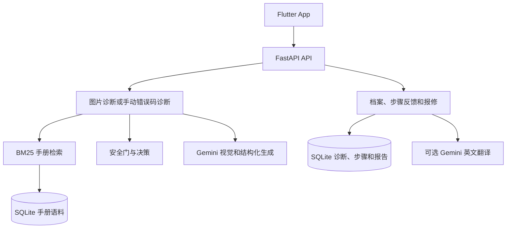

# SnapFix 随手修

> 拍下问题，核对依据，再决定自行处理、联系房东或预约专业人员。
> *Snap it. Fix it. Or report it.*

COMP7506A Smart Phone Apps Development 小组项目。SnapFix 是一款以 Flutter 开发的跨平台手机应用，配合 FastAPI 后端，帮助租户记录家电或家具问题、查找说明书依据、获得安全处理建议，并生成中英文报修草稿。

本 README 说明如何取得源码、安装依赖、编译及运行应用。课程所需的背景调研、应用设计和成员贡献说明见 [项目报告草稿](docs/final-report-draft.md)。

## 1. 项目功能

| 功能 | 当前行为 |
|---|---|
| 拍照或相册选择 | Flutter App 支持相机和相册入口；后端先检查图片尺寸、亮度和清晰度。 |
| 手动错误码诊断 | 输入品牌和错误码后检索本地说明书。例如 Bosch E24 会召回洗碗机说明书第 35 页。 |
| 手册检索 | 使用 BM25，对品牌别名、设备类别提示和错误码精确匹配加权；无匹配时明确返回空结果。 |
| 安全处理 | 高风险维修请求返回拒答和专业求助建议，不提供拆机步骤。 |
| 分步反馈 | 用户可将步骤标记为完成、没用或跳过；反馈会写入 SQLite。 |
| 报修草稿 | 根据设备信息、已完成步骤和照片文件名引用生成中文或英文草稿。 |
| 维修档案 | SQLite 保存诊断、步骤反馈和报告。重启后保留；删除诊断时关联步骤和报告会一并删除。 |
| 离线演示 | 没有 Gemini key 时使用明确标注的 mock 演示场景，方便课堂离线展示。 |

## 2. 系统架构



每条诊断使用 `source_mode` 区分结果来源：`mock` 为离线演示数据，`retrieval` 为手动错误码查询到的本地手册结果，`gemini` 为真实图片管线成功返回的结果。

## 3. 代码结构

```text
app/                         Flutter 手机应用
  lib/product/               当前产品界面和 API 调用
  integration_test/          App 集成测试
server/                      FastAPI 后端
  main.py                    v1 API 和请求校验
  pipeline.py                图片质量、视觉、检索、安全和引用校验流程
  retrieval.py               BM25、别名、同义词和加权排序
  session_store.py           SQLite 档案、反馈和报告存储
  corpus_store.py            JSON 语料导入
  data/                      说明书元数据、切块和公开 PDF
  tests/                     后端自动化测试
docs/                        API 契约、调研、验收、演示说明和报告草稿
landing/                     静态项目展示页
```

## 4. 环境要求

| 组件 | macOS | Windows |
|---|---|---|
| Python | Python 3.11 或以上 | Python 3.11 或以上，并在安装时勾选 Add Python to PATH |
| Flutter | Flutter 3.47+、Dart 3.13+、Xcode（运行 iOS Simulator 时） | Flutter 3.47+、Dart 3.13+、Android Studio 与 Android Emulator |
| Git | Git | Git for Windows |
| 网络 | 首次安装 Python 与 Flutter 依赖时需要 | 首次安装 Python 与 Flutter 依赖时需要 |

SQLite 随 Python 提供，不需要额外安装数据库服务。没有 Gemini key 也可运行后端、检索、档案、离线图片演示和基础中英文报修。

## 5. 获取源码

```bash
git clone https://github.com/junjiacaohku-ai/snapfix.git
cd snapfix
```

若要使用当前全栈集成版本，请执行：

```bash
git switch integration/w3-product
```

## 6. 启动后端

后端必须先启动。以下命令均在项目根目录执行。

### macOS

```bash
cd server
python3 -m venv .venv
source .venv/bin/activate
python -m pip install -r requirements.txt -r requirements-dev.txt
python -X utf8 corpus_store.py --database data/snapfix.db
python -m uvicorn main:app --host 127.0.0.1 --port 8000
```

### Windows PowerShell

```powershell
cd server
python -m venv .venv
.\.venv\Scripts\Activate.ps1
python -m pip install -r requirements.txt -r requirements-dev.txt
python -X utf8 corpus_store.py --database data/snapfix.db
python -m uvicorn main:app --host 127.0.0.1 --port 8000
```

如果 PowerShell 不允许执行激活脚本，请不要激活环境，改用以下形式执行之后每一条 Python 命令：

```powershell
.\.venv\Scripts\python.exe -m pip install -r requirements.txt -r requirements-dev.txt
.\.venv\Scripts\python.exe -X utf8 corpus_store.py --database data/snapfix.db
.\.venv\Scripts\python.exe -m uvicorn main:app --host 127.0.0.1 --port 8000
```

导入完成时应显示：

```json
{"manuals": 16, "chunks": 2032}
```

浏览器打开 [http://127.0.0.1:8000/docs](http://127.0.0.1:8000/docs)，可使用 Swagger 页面测试 API。

若终端显示 `Address already in use`，表示 8000 已被其他程序使用。可先停止旧服务，或改用 `--port 8001`，并把下文 App 的地址中的 `8000` 一并改为 `8001`。

## 7. Gemini 与离线模式

默认没有 key 时，后端运行在确定性的离线 mock 模式。它适合测试和课堂备用演示，但不代表真实图片识别结果。

如需尝试真实图片管线或英文步骤翻译，在 `server` 目录复制模板并填写自己的 key：

### macOS

```bash
cd server
cp .env.example .env
```

### Windows PowerShell

```powershell
cd server
Copy-Item .env.example .env
```

编辑 `.env`：

```dotenv
GEMINI_API_KEY=你的真实密钥
```

配置 key 且没有设置 `SNAPFIX_MOCK=1` 时，图片接口会尝试真实管线。真实图片或生成调用失败后，只有文件名符合约定的演示图片才会回退到 mock 场景。`.env`、数据库和 `.venv` 已被忽略，不能提交到 Git。

## 8. 编译和运行 Flutter App

保持第 6 节的后端终端继续运行。另开一个终端，在项目根目录执行。

### macOS：iOS Simulator

```bash
cd app
flutter pub get
flutter devices
flutter run --dart-define=SNAPFIX_API=http://127.0.0.1:8000
```

需要先在 Xcode 中安装至少一个 iOS Simulator。可用 `flutter devices` 查看设备名称，再按提示选择。

### Windows：Android Emulator

先在 Android Studio 的 Device Manager 启动 Android Emulator，然后执行：

```powershell
cd app
flutter pub get
flutter devices
flutter run --dart-define=SNAPFIX_API=http://10.0.2.2:8000
```

`10.0.2.2` 是 Android Emulator 访问开发电脑后端的专用地址。Windows 不能运行 iOS Simulator；macOS 可以运行 Android Emulator，但连接地址仍使用 `10.0.2.2`。

### 浏览器预览

浏览器预览适合检查页面流程，不替代手机相机、权限、系统分享验收。

```bash
cd app
flutter pub get
flutter build web
```

构建后在另一个终端运行：

### macOS

```bash
cd server
source .venv/bin/activate
python run_fe2_preview.py
```

### Windows PowerShell

```powershell
cd server
.\.venv\Scripts\Activate.ps1
python run_fe2_preview.py
```

打开 [http://127.0.0.1:8000](http://127.0.0.1:8000)。若使用 8001，请访问 `http://127.0.0.1:8001`。

## 9. 使用流程

1. 在首页选择拍照、相册或手动输入错误码。
2. 对图片，系统先做质量检查。图片过暗、过糊或尺寸不足时，按提示重拍。
3. 对手动输入，填写品牌和错误码，查看对应手册候选、处理决策和引用信息。
4. 在指导页标记步骤为完成、没用或跳过。
5. 在报修页选择中文或英文草稿。报告只会列出标记为完成的步骤；照片引用只是文件名，发送时仍须自行附上原图。
6. 在档案页查看历史记录。删除诊断会删除其步骤和报告草稿。

## 10. 测试与验收

在 `server` 目录执行以下命令。

### macOS

```bash
source .venv/bin/activate
python -X utf8 -m pytest tests -q
python experiments/run_acceptance.py --label mac --output ../mac-acceptance.json
python experiments/run_server_checks.py
```

### Windows PowerShell

```powershell
.\.venv\Scripts\Activate.ps1
python -X utf8 -m pytest tests -q
python experiments/run_acceptance.py --label windows --output ..\windows-acceptance.json
python experiments/run_server_checks.py
```

`pytest` 检查语料导入、BM25 检索、错误码误匹配防护、安全规则、图片质量、反馈、报修、重启和级联删除。`run_acceptance.py` 重放六个离线后端场景，`run_server_checks.py` 使用真实本地 HTTP 与临时 SQLite 检查持久化。

Flutter 检查命令如下，macOS 和 Windows 相同：

```bash
cd app
flutter analyze
flutter test
```

更多六场景输入、预期结果和手机记录表见 [演示清单](docs/demo-runbook.md)。当前已保存的 BE-2 macOS 离线验收记录见 [BE-2 验收记录](docs/BE2-acceptance-2026-11-10.md)。

## 11. API 概览

| 方法 | 路径 | 用途 |
|---|---|---|
| `GET` | `/api/health` | 查看 mock 或 Gemini 配置状态。 |
| `POST` | `/api/analyze/image` | 上传图片并创建诊断。 |
| `POST` | `/api/diagnose/manual` | 手动输入品牌和错误码。 |
| `POST` | `/api/manuals/search` | 搜索说明书切块。 |
| `GET` | `/api/sessions` | 读取诊断档案。 |
| `POST` | `/api/sessions/{id}/steps/{step_id}/feedback` | 保存步骤反馈。 |
| `POST` | `/api/sessions/{id}/report` | 生成中英文报修草稿。 |
| `DELETE` | `/api/sessions/{id}` | 删除诊断及关联数据。 |

完整请求字段、状态码和前端处理约定见 [API 契约](docs/api-contract.md)。

## 12. 当前边界

- 真实 Gemini 在线调用、真实故障照片识别准确率、Android 实机、真实手机拍照和系统分享需要分别验收。
- 手动错误码诊断会返回手册候选与安全建议。设备完整型号未核实或没有可靠引用时，系统不会提供自行拆修步骤。
- 英文报告在无法调用翻译服务时仍会生成，但只列出已完成步骤编号并说明正文未翻译。
- `source_mode=mock` 的结果用于演示，不能作为真实识别准确率证据。

## 13. 分工与相关文档

| 负责线 | 成员 | 主要内容 |
|---|---|---|
| BE-1 | 曹峻嘉 | API 契约、图片管线、provider、安全门和部署 |
| BE-2 | 史珺瑛 | BM25、SQLite、报修端点、README |
| FE-1 | 朱雨泰民 | 相机/相册、分析过程、诊断结果和录屏 |
| FE-2 | 杨蕊嘉 | 分步反馈、档案、报修界面、设计与视频 |
| D | 张帆 | 说明书语料、ETL、验收素材、调研与评估 |

- [后端详细说明](server/README.md)
- [Flutter App 说明](app/README.md)
- [四周冲刺计划](docs/2026-10-22%20SnapFix%20四周冲刺计划.md)
- [数据交接说明](docs/data-handoff.md)
- [项目报告草稿](docs/final-report-draft.md)
