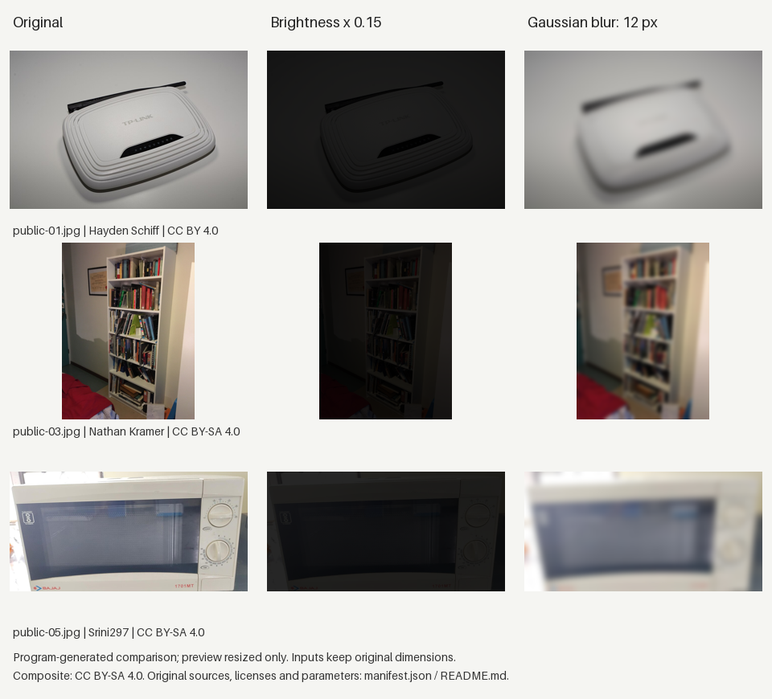

# 图片对照实验

13张公开原图去重后各做两种处理，得到26张处理图，原文件保留：
- 暗化：RGB通道亮度乘以0.15。
- 模糊：在原尺寸上做半径12像素的高斯模糊。

处理前统一EXIF方向并转RGB，不缩放；结果存为无损PNG。来源、作者、原许可和处理方式写进PNG信息及 `manifest.json`。各张处理图沿用对应原图许可，来源表见 [public/sources.json](../public/sources.json)。

结果：13张暗化图全部提示过暗；12张基线放行原图的模糊版本全部提示重拍。剩下1张原图本来偏暗，其模糊版本单列，没算作模糊检查成功。包含原图的39次上传检查均符合预期，上传统一使用 `router.jpg`，排除了文件名触发重拍的可能。

检查阈值保持原版不变。同设备的多张照片归入同组，共10个来源组；这只是强暗化/强模糊的对照测试，不能当作手机拍摄准确率或故障识别结果。

在 `server/` 重现：

```sh
python experiments/build_quality_variants.py
python experiments/evaluate_quality_variants.py
```

逐条结果见 `server/experiments/quality-variant-results.json`（仓库根目录起）。Python、Pillow版本和输入输出哈希都在清单中。



预览图仅为展示缩小。三行原图分别来自 [Hayden Schiff](https://commons.wikimedia.org/wiki/File:TP-Link_TL-WR740N_router_HS2.jpg)（[CC BY 4.0](https://creativecommons.org/licenses/by/4.0/)）、[Nathan Kramer](https://commons.wikimedia.org/wiki/File:Billy_Bookcase.jpg) 和 [Srini297](https://commons.wikimedia.org/wiki/File:Microwave_Oven.jpg)（均为 [CC BY-SA 4.0](https://creativecommons.org/licenses/by-sa/4.0/)）；拼图按CC BY-SA 4.0提供。
