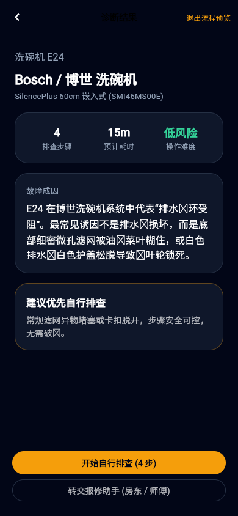

# 杨蕊嘉 FE-2 W1/W2 交付与预览

本分支依赖 FE-1 基础工程（PR #2）和 BE-2 存储检索（PR #4），通过 merge 保留原作者和提交历史。请先审阅这两个依赖，依赖合入后再复核本分支差异；本分支不包含 BE-1 真实图片诊断。新增代码主要在 `app/lib/product/`、`server/ui_api.py`，详细责任和限制见 [贡献说明](contributions.md)、[验收记录](validation.md)。

## 看界面

下图来自此前完整交付版的 Flutter Web 实际运行，作为视觉参考；此 PR 源码的独立验证见验收记录。样例保留“开始自行排查”和“转交报修助手”两个入口。



[首页](previews/flutter-home.png) · [步骤反馈](previews/flutter-guide.png) · [维修记录](previews/flutter-history.png) · [报修助手](previews/flutter-report.png)

## 本地浏览器运行

需要 Python 3.11+ 和已配置的 Flutter SDK。先在项目根目录创建 Python 虚拟环境并安装 `server/requirements.txt`，可参考根 README；无需模型密钥。分别在两个终端执行：

```powershell
# 先编译 Flutter 网页，不指定 SNAPFIX_API 时自动使用同源接口。
cd app
flutter pub get
flutter build web
```

```powershell
# 在项目根目录，使用已安装后端依赖的 Python。
python server/run_fe2_preview.py
```

保持服务运行，打开 http://127.0.0.1:8051 。通过右上角唯一的“预览使用流程”入口查看四步 E24 样例、反馈和报修；普通上传保存实际照片，但真实识别尚未接通，会显示“还在学习该维修技能中！”。预览和正式记录分开保存，不以演示结果冒充识别。

## Android 模拟器

在一个终端运行 `python -m uvicorn main:app --app-dir server --port 8051`，另一个终端进入 `app` 后执行 `flutter run --dart-define=SNAPFIX_API=http://10.0.2.2:8051`。本分支仅在 Android debug 配置中允许课堂本地 HTTP。真实手机地址需另行配置，手机拍照、原生分享及 iOS 尚需设备验收。

## 检查

```powershell
cd server
python -m pip install -r requirements-dev.txt
python -X utf8 -m pytest -q
```

在 `app` 目录执行 `flutter analyze` 和 `flutter test`。数据库、密钥、构建目录和 APK 不提交 Git；原始 AI Studio 工程、React 参考版、APK 和视频另在本地完整交付包中。
