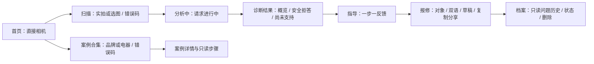

# 视觉规范与结构

视觉基准是杨蕊嘉确认的 Google AI Studio 版本，原始源码独立保存在 design-reference，web 是连接后端的参考实现，app 是 Flutter 原生移植。原项目视觉及相机骨架来自 FE-1，不把移植工作表述为其原创主题。

- 主背景 #0B1020、卡片 #16203D、主操作 #F5A623、次级文字 #9AA7C7、边框 #24335C，与 `landing/index.html` 和 FE-1 主题保持一致。
- 圆角卡片22px、胶囊按钮、主操作高度至少44px、页面侧边距24px。Flutter 步骤正文≥16pt，标题约22pt。
- 首页直接进入拍摄意图，底栏左合集、中拍照、右档案；照片与错误码是平行输入。
- 案例单列大图+描述，品牌/电器切换保留，不改为网格；浏览步骤不写入个人记录。
- 诊断先概览，排查一屏一步；历史问题与步骤只读，维修状态通过单独确认修改。
- 报修对象房东/维修师傅/官方售后，中文/English，正文可编辑，复制/系统分享/存草稿。
- 适配小屏采用滚动和安全区域，键盘弹出保留输入位置。Flutter 相机调用设备相机；网页使用 getUserMedia 实时取景。

## W1 五屏线框关系

原始参考包含启动、相机、案例、诊断、步骤、报修、档案等页面，超过W1最低骨架范围。“分析中”目前为真实请求期间的忙碌状态；真实识别管线没有返回阶段事件时，不伪装已经执行“查手册”等阶段。视觉是否最终通过，由杨蕊嘉及前端队友评审，不由自动测试代替。